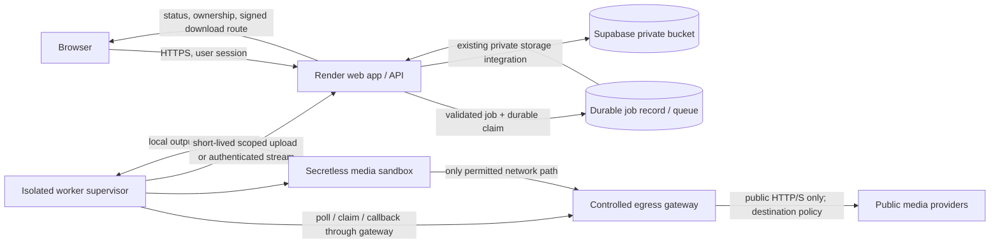

# MF-01 Infrastructure Options and Recommendation

**Review date:** 2026-10-19  
**Repository:** `/data/data/com.termux/files/home/mediaforge-git`  
**Branch / HEAD:** `main` / `c51b87a`  
**Current decision:** **BLOCK RELEASE**  
**Recommendation:** **B. Move media processing into an isolated worker with enforceable egress controls.**

This report is read-only research and source inspection. No production URL or service was tested; no dashboard, credentials, or secret-bearing environment was accessed. No source, configuration, or prior report was changed. The recommendation is a design proposal, not implementation approval, and MF-01 remains open.

## Repository and architecture evidence

At review, the repository remained on `main` at `c51b87a`. Staged/unstaged source changes and the three existing untracked security reports were preserved. The requested report path was absent before this report was created.

The four requested reports were read: the Phase 1 audit, Phase 2 remediation, MF-01 production egress verification, and `SSRF_EGRESS_LIMITATIONS.md`. Current implementation files inspected included `Dockerfile`, `.env.example`, `server/ytDlpService.ts`, `server/ffmpeg.ts`, `server/security.ts`, `server/outboundHttp.ts`, `server/queue.ts`, `server/postgres.ts`, `server/redis.ts`, `server/db.ts`, `server/supabase.ts`, `server/socialDownload.ts`, `server/mediaEgressRoutes.ts`, and the relevant Render/deployment file listing.

### Current data flow and boundaries

- The browser submits media requests to the Express app. The app performs authentication, ownership checks, initial URL validation, and provider/API operations.
- `server/ytDlpService.ts` requires `YTDLP_PROXY_URL` when `NODE_ENV=production` and supplies `--proxy` to both metadata and download invocations. It empties `NO_PROXY` and `no_proxy`. These are code controls, not network enforcement.
- `validateAndNormalizeUrlAsync` resolves and checks the initial URL but does not pass pinned addresses to yt-dlp. yt-dlp performs its own redirects, extractor requests, format/fragment/CDN requests, and any helper-runtime networking.
- The Node HTTP paths using `server/outboundHttp.ts` validate and pin DNS answers and validate redirect hops. That transport does not govern yt-dlp sockets.
- FFmpeg/FFprobe normally process local files after acquisition; yt-dlp remains the principal subprocess egress path.
- The current queue is in-process. `BackgroundJobQueue.createJob` puts jobs in `db.jobs` (a `Map`), calls `processJob` immediately, and asynchronously persists a snapshot with `postgresManager.saveJob`. Postgres `getJobs` reads snapshots; no atomic claim/lease or cross-process queue consumer was found. Redis `cacheJob` is caching, not evidence of a durable work queue.
- Existing completion stores media in the configured Supabase bucket and exposes application-authorized download routes. Production bucket policies are not verified by this repository review.
- The repository has a Dockerfile but no Render service manifest or egress/firewall policy. The Dockerfile builds `linux/amd64`, installs yt-dlp and FFmpeg, and runs as `node`; it declares no network isolation.

## Current Render capabilities and conclusion

Current official Render documentation was reviewed on 2026-10-19:

- Render’s [outbound IP documentation](https://render.com/docs/outbound-ip-addresses) describes service egress IP ranges for allowlisting at external systems. Its [dedicated outbound IP documentation](https://render.com/docs/dedicated-ips) says dedicated IPs provide stable, workspace-exclusive IPv4 source addresses and carry an additional monthly fee. These identify the source of traffic; they do not filter its destination or stop a process from connecting directly.
- Render’s [private networking documentation](https://render.com/docs/private-network) describes same-region service-to-service private connectivity. Its [environment isolation documentation](https://render.com/docs/projects#blocking-cross-environment-traffic) explicitly says cross-environment blocking only affects private network traffic. Those features do not constrain a media process from making public Internet requests.
- Render [private services and background workers](https://render.com/docs/private-services) are not publicly reachable; workers can initiate requests and typically consume jobs from a queue. A private service is reachable by same-region services. Neither page documents outbound destination ACLs, per-process policy routing, mandatory proxy enforcement, or a network egress firewall for service-initiated public traffic.
- Render’s [inbound IP rules](https://render.com/docs/inbound-ip-rules) are inbound controls; the docs say background workers and private services do not receive public Internet traffic. Inbound rules cannot enforce outbound SSRF policy.
- Render’s [plan feature matrix](https://render.com/docs/platform-features-by-plan) describes dedicated outbound IPs, private-network environment isolation, private links, and inbound IP restrictions as distinct features. It does not document outbound destination filtering.

**Conclusion:** The documented Render controls available in the reviewed sources do not establish that the current Render app can enforce MF-01. A paid static/dedicated outbound IP is not an egress firewall. Adding a Render background worker or private service by itself would also not solve MF-01 because the documented controls do not prevent public direct egress from that process. This is a conclusion about documented and evidenced controls, not a claim that Render has no unpublished or support-mediated capability. The owner can ask Render Support for written confirmation of any service-level outbound destination filtering or forced-proxy control; absent specific evidence and a controlled demonstration, do not rely on it.

## Options compared

| Option | Security result for MF-01 | Cost | Complexity / operations | Decision |
|---|---|---|---|---|
| **A. Keep the current Render app and configure `YTDLP_PROXY_URL` or a dedicated outbound IP** | Proxy argument is bypassable unless a network boundary prevents direct egress; static IP only labels source. Render’s documented private-network isolation is not public egress filtering. A Render-hosted worker plus the same proxy setting has the same gap. | Lowest change cost; dedicated Render IPs add a current-price-to-confirm monthly charge; a separate Render worker adds compute cost. Neither expense proves the needed control. | Low migration effort, but unresolved policy question and no evidenced egress boundary. | **Not acceptable on present evidence.** Reconsider only if Render confirms/enables enforceable egress filtering and it passes the criteria below. |
| **B. Keep Render as web/control plane; run media processing in a separate, egress-restricted worker environment with a controlled gateway** | Worker network rules deny direct destinations except the gateway. Gateway checks the actual resolved destination on connection, and checks each new redirect/request. Media sandbox has no credentials and no network route except the gateway. | A low-volume self-managed two-VM design can be inexpensive; estimate below. Managed AWS Network Firewall is robust but materially more expensive in the cited reference deployment. | Medium/high: new durable queue/lease protocol, worker lifecycle, proxy policy, firewall maintenance, monitoring, and staging acceptance tests. Single worker/gateway pair is a reliability bottleneck; fail closed when unavailable. | **Preferred practical path.** It provides a control boundary that the operator can configure and test independently of Render. |
| **C. Keep release blocked because no affordable enforceable option has been established** | Safest immediate status while evidence is missing. | No new infra cost. | No migration, but media processing stays unavailable/unsafe for release. | Correct as the current release status until B is implemented and verified. |

### Affordable B candidate and important caveats

Use a separate x86 Linux worker VM and a separate small egress-gateway VM with a stable public address. Keep the Render service in place. The two VMs can use a low-cost provider whose cloud firewall supports outbound allow rules. For example, Hetzner’s current published [price adjustment table](https://docs.hetzner.com/general/infrastructure-and-availability/price-adjustment/) lists US CX23 at **$6.49/month each, excluding IPv4**, and EU CX23 at **€5.49/month each, excluding IPv4**. Two CX23 instances therefore have a published compute floor of about **$12.98/month** (US) or **€10.98/month** (EU), before IPv4, VAT, backups/volumes, excess traffic, and operations. CX23 is listed as 2 vCPU, 4 GB RAM, and 40 GB NVMe on the [current product page](https://www.hetzner.com/cloud/cost-optimized/); availability and best-fit capacity must be checked at purchase time. Shared CPU is variable, so start at one job at a time and benchmark authorized staging workloads before sizing production.

Hetzner states that its [Cloud Firewalls are free](https://docs.hetzner.com/cloud/firewalls/overview/) and that when custom outbound rules exist, other new outbound traffic is dropped ([firewall FAQ](https://docs.hetzner.com/cloud/firewalls/faq/)). This is useful for worker-to-gateway allowlisting. **Critical caveat:** the same FAQ says metadata requests are answered locally and do not pass through that cloud firewall; it also says private Cloud Network traffic is not secured by these firewall rules. Therefore add host-level filtering for metadata/link-local destinations, do not treat Hetzner firewall rules alone as complete, and test actual traffic paths. Configure the worker’s outbound allowlist to permit only the gateway endpoint (and only narrowly required DNS/control-plane traffic); the worker must not have a general Internet egress rule. The gateway must use a separate host firewall and proxy ACL, with operator-maintained IPv4 and IPv6 blocked ranges.

This is a cost candidate, not a production-ready validated configuration. The provider, region, exact compute plan, outbound transfer allowance, IP cost, legal/data-location requirements, and service availability require owner review. It is still self-managed security software: the operator must patch the OS and proxy, monitor firewall drift, keep recovery access, and re-run regression tests after upgrades.

For comparison, an AWS-managed Network Firewall design has higher reliability/management support but a much higher baseline in AWS’s published [cross-network inspection reference](https://docs.aws.amazon.com/solutions/latest/centralized-network-inspection-on-aws/cost.html): **approximately $620.55/month** for its us-east-1 reference topology, including two firewall endpoints and Transit Gateway charges. That is not a quote or a minimum price for this application; it is evidence that this managed inspection pattern is unlikely to be the simplest affordable first deployment. AWS [security groups](https://docs.aws.amazon.com/vpc/latest/userguide/security-group-rules.html) can restrict egress with allow-only rules and can reference security groups, but they do not have deny rules; they are useful to ensure a worker can contact only a gateway, while the gateway still needs destination-aware filtering.

## Preferred architecture

### Responsibilities and enforcement

1. **Render remains the public application/control plane.** It accepts browser requests, authenticates the account, validates allowed URL syntax, applies per-user limits, creates the existing job ID and owner association, and remains authoritative for job status/cancellation and downloads. Existing Node HTTP calls continue using `requestSafeHttp` and its destination pinning. This keeps ordinary provider API traffic in the existing Node boundary.

2. **Add a durable cross-process job claim.** The Render app writes an atomic queued record/outbox and lease; a separate worker supervisor polls a narrow authenticated app endpoint or a properly configured durable queue. The current `db.jobs` map and Postgres snapshot methods do not provide atomic work claiming. Do not assume Upstash cache methods are a work queue. Claims need idempotency, bounded leases, heartbeat, retry count, cancellation signal, and stale-job recovery. The job payload should contain only required normalized input, format, quality, storage/job identifiers, expiration, and a scoped upload capability; never forward browser session cookies.

3. **Only the supervisor handles control credentials.** Authenticate supervisor-to-Render calls using mTLS or a timestamped HMAC request signature with nonce/replay protection and a short expiry, plus job ID and lease binding. Restrict the worker credential to claim/status/cancel/upload operations; do not give it user/admin database access. The media sandbox receives no HMAC, database, Supabase service-role, Redis, or proxy authentication secrets. Pass a minimal environment to yt-dlp and FFmpeg.

4. **Run yt-dlp in a disposable, unprivileged sandbox.** Use a non-root container/user, read-only root filesystem, one per-job writable directory, CPU/memory/PID/file-size/time limits, bounded stdout/stderr, and explicit process-tree termination. Start at one concurrent download on a small VM; increase only after measured CPU, memory, and disk headroom. FFmpeg/FFprobe process local files only and receive no network access. Keep cookies disabled unless a documented provider requirement exists; if needed, expose a read-only job-scoped cookie file only to the extractor and clean it after the job.

5. **Enforce two network gates.** At the provider firewall, worker VM egress allows only the gateway address and the minimal required control-plane path; deny all other new outbound connections for both IPv4 and IPv6. At the host/container firewall, the media sandbox can connect only to the gateway listener; it cannot use an alternate interface, DNS resolver, host network, or direct IPv4/IPv6 path. Apply an explicit host-level deny for loopback, private, link-local, unspecified, multicast, reserved/shared-use, metadata, IPv4-mapped and relevant IPv6 transition ranges, including local metadata service routes. No worker cloud role or credential endpoint should be available to the sandbox.

6. **Use a controlled HTTP forward proxy at the gateway.** A maintained Squid release is one candidate, not a pre-validated selection. Squid’s official [ACL documentation](https://www.squid-cache.org/Doc/config/acl/) documents a `dst` ACL that matches the destination IP for a URL, while its [ACL FAQ](https://wiki.squid-cache.org/SquidFaq/SquidAcl) describes DNS lookups for IP-based matching. Configure a default-deny policy for unsafe destination ranges, allow only required HTTP proxy methods and CONNECT to the intended TLS port, deny proxy management/listener access from all but the worker, and disallow proxy chaining or alternate protocols. Require the implementation to filter the actual address selected for the outbound socket after DNS resolution, reject mixed unsafe DNS results, and fail closed if it cannot establish the destination. Squid ACL documentation alone does not prove race-free DNS pinning or IPv4/IPv6 completeness; verify the exact deployed Squid version/configuration with controlled tests and connection logs. Do not TLS-intercept public media traffic.

7. **Recheck at every request and redirect.** yt-dlp must send every metadata, redirect, format, fragment, and CDN request through the proxy. For an HTTPS CONNECT tunnel, the proxy cannot inspect encrypted response headers; yt-dlp’s redirect-following client must submit each redirected host through the proxy again, where that new CONNECT is filtered before the tunnel is opened. This behavior must be proven for supported extractors in staging. Block the request if any helper or extractor makes direct egress or uses an unsupported protocol.

8. **Proxy and worker authentication.** Restrict gateway ingress with provider firewall source rules to the worker’s stable address and a single TLS listener; use TLS with certificate verification from the worker. If source addresses are not stable or the provider cannot enforce this, use mTLS at the proxy or a gateway that supports authenticated clients. The current application rejects credentials embedded in `YTDLP_PROXY_URL`, so do not rely on URL user/password authentication without a reviewed code change. Keep the worker’s Render control API signature secret in the supervisor only; never log proxy URLs, HMACs, signed storage URLs, source query strings, or cookies.

9. **Preserve storage and downloads.** Prefer a short-lived, object-path-scoped Supabase upload capability minted by the Render app and used by the supervisor (not the media sandbox), or stream a bounded file to a narrowly authenticated Render upload endpoint. The app verifies job lease, expected key, size, MIME/content signature, checksum, and job owner before marking READY. The app keeps the private bucket, owner checks, and existing signed download delivery. The worker never returns storage/service credentials to the browser.

10. **Limit jobs and clean up.** Enforce queue depth and per-user creation limits in the app; worker concurrency one initially; max source URL length and supported protocols; bounded retries and total execution time; max media bytes (current code cap is 512 MiB); per-job disk quota and total worker disk alarm; cleanup on success, error, timeout, cancellation, and reboot. Expired leases return to a bounded retry policy, not duplicate unbounded work. A gateway outage fails media jobs safely and does not fall back to direct egress.

## Costs, operations, and trade-offs

| Design | Published cost evidence | Operational complexity / trade-off |
|---|---|---|
| Existing Render app + proxy URL/static outbound IP | Render’s current [pricing](https://render.com/pricing) and docs say dedicated outbound IP sets have an extra monthly fee; exact fee is shown in the Dashboard. Render service/worker compute is billed separately. | Cheap to try, but does not enforce destination filtering or stop direct egress. Not a security solution for MF-01. |
| Two low-cost worker/gateway VMs with provider egress allowlisting and a host-filtered proxy | Example Hetzner CX23 pair: approximately $12.98/month in US or €10.98/month in EU using the June 2026 price table, before IPv4, tax, traffic overages/add-ons. Hetzner cloud firewall is published as no-charge. | Affordable compute baseline, but self-managed OS/firewall/proxy, patching, monitoring, availability, backups, and abuse response. One worker and one gateway are single points of failure. Shared CPU may make processing slow; size after staging measurements. Provider metadata/firewall caveats require host-level controls. |
| AWS with worker egress SG restricted to a proxy gateway | AWS security groups are no-charge; worker can be allowlisted to the gateway’s SG. Managed Network Firewall reference architecture is ~$620.55/month in the cited region/topology, not an app-specific minimum. | Stronger managed network primitives and scaling options, but VPC, queue, IAM, NAT/endpoints, logging, and policy operations are more complex; full managed firewall likely exceeds an affordable starter budget. |

Prices and plan features are dynamic and region-dependent. Verify actual quotes, bandwidth/transfer fees, data location, instance availability, IPv4 charges, and service terms before choosing. No Render account plan or existing service price was available during this review.

## Migration and rollback sequence

1. **Design approval and provider validation:** choose region/provider, review data residency and abuse/acceptable-use rules, verify current network firewall semantics (especially metadata and private network behavior), and obtain the exact VM quote. Keep Render as-is.
2. **Build an isolated staging gateway and worker:** implement the proxy ACL and network/firewall rules with default deny, including both address families and metadata blocking. Configure logs and update ownership. No production secrets or media are needed.
3. **Prove network enforcement before application integration:** demonstrate direct egress from the sandbox is denied; prove only the proxy is reachable; test the proxy’s actual connection address policy against controlled owned public/private sink fixtures, redirects, DNS changes, IPv4/IPv6 and alternate encodings. Confirm no production/internal destinations are used.
4. **Add durable queue and control API:** replace fire-and-forget in-process execution with atomic job claims, leases, retries, cancellation, status callbacks, idempotency, and supervisor authentication. Preserve existing user ownership at the Render app.
5. **Move processing and storage handoff:** run yt-dlp within the sandbox; FFmpeg operates offline on the downloaded file. Keep secrets in the supervisor; upload to private storage via narrowly scoped short-lived capability. Preserve current API response and download semantics.
6. **Run authorized staging end-to-end tests:** test legitimate provider flows, failures, cancellation, worker/gateway restart, queue recovery, cleanup, size/concurrency limits, upload authorization, and access by a second synthetic user. Capture redacted configs and logs.
7. **Production rollout only after separate approval:** configure production worker/gateway and app endpoints, deploy in a controlled window, compare production policy to the tested staging policy, and enable a small percentage or one-job-at-a-time rollout. This research does not authorize any external change or deployment.

**Rollback:** pause job claims and disable media processing if the worker/gateway fails. Keep jobs queued or mark them retryable with bounded expiry. Do not route jobs back to the old unrestricted in-process yt-dlp path. Revert control-plane integration only while media processing remains disabled or an equivalent enforced egress policy is active. Retain logs and artifacts for investigation; do not delete user work or reports.

## Acceptance criteria before MF-01 can close

All of the following require evidence for the deployed production revision and the exact worker/gateway policy:

1. Render remains the authentication and ownership authority; jobs are claimed once under a durable lease and workers cannot access or modify other users’ jobs.
2. The worker’s effective IPv4 and IPv6 egress rules show deny-by-default and allow only the gateway/control paths explicitly needed. A harmless direct connection attempt from the same sandbox/process context is blocked by the network boundary and creates an auditable deny result.
3. yt-dlp metadata, normal downloads, redirects, format/fragment requests, and supported extractor helper traffic are observed using the proxy. No alternate direct socket, DNS-over-HTTPS, tunnel, proxy bypass, or unsupported protocol succeeds. Any necessary direct DNS is narrowly defined and cannot connect to destinations.
4. The proxy’s exact version/configuration rejects at connection time: IPv4/IPv6 loopback, private, link-local, unspecified, multicast, reserved/shared-use, metadata, IPv4-mapped and relevant transition ranges; mixed or changing DNS answers; noncanonical/alternate numeric IP forms; unsafe ports/protocols; and redirect chains to any blocked owned sink. Evidence shows the rejected address was never contacted. The test endpoints and DNS fixtures are controlled by the operator.
5. The same proxy check runs for every redirect/new connection. For HTTPS, verify the client creates a new proxy request for redirected hosts. Public normal media fixtures succeed and complete downloads remain within size/time limits.
6. No cloud metadata credentials or service secrets are available in the media sandbox; child environments and mounts are reviewed. Logs redact source query strings, cookies, tokens, proxy auth, signed URLs, and user content.
7. Queue recovery, cancellation, per-user quotas, concurrency, storage upload scope, checksum/content validation, temp cleanup, disk alarms, and failure behavior are tested. Gateway/Redis/queue outage fails closed without direct-egress fallback.
8. Production service configuration is inspected by its owner and shown to match the tested revision, proxy version, firewall policy, host rules, and worker network namespace. Provider limitations/exceptions are documented and accepted by the security owner.

If any route, process, IP family, protocol, metadata service, DNS behavior, or redirect is not covered, MF-01 remains open and release remains blocked. A proxy variable, successful ordinary download, static outbound IP, or private-network isolation alone does not meet these criteria.

## Assumptions and limitations

- The current Render production region, workspace plan, dashboard settings, deployed commit, and service egress policy were not accessible; this report does not claim to know them.
- Official docs were reviewed as public documentation; Render Support was not contacted. A support statement could change the assessment only if it describes an enforceable service-level egress mechanism and the mechanism is configured and verified.
- Render’s documented outbound IP feature is source identification/allowlisting. The documented private environment boundary concerns private network traffic. No documented destination allowlist/firewall or mandatory per-process proxy feature was located.
- Hetzner Cloud Firewall documentation says local metadata requests bypass its filter and private Cloud Network traffic is not protected by it. The proposed host filtering and controlled tests are mandatory; the provider firewall alone is insufficient.
- Squid is a candidate proxy only. Its docs establish IP destination ACL functionality, but do not by themselves prove race-free DNS resolution, complete IPv6/special-use coverage, arbitrary extractor compatibility, or policy correctness. Version-specific behavior must be verified.
- Current app queue and storage behavior will require source changes and likely a durable queue/worker protocol; this report makes no code changes.
- Legal, copyright, provider terms, media retention, and country-specific data protection decisions are outside this infrastructure security assessment.

## Final recommendation

**B. Move media processing into an isolated worker with enforceable egress controls.** Keep the Render application as the authenticated control plane and move yt-dlp/FFmpeg to a separate worker whose network cannot reach media destinations directly. Use a default-deny worker egress rule and a controlled, destination-filtering proxy/gateway that checks resolved addresses and each new redirect connection. A low-cost two-VM setup is a plausible affordable starting point, subject to exact pricing, provider policy, host-level metadata protection, and successful controlled staging evidence. **MF-01 is not fixed; release remains BLOCK RELEASE until the acceptance criteria are met.**
